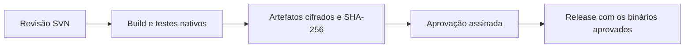
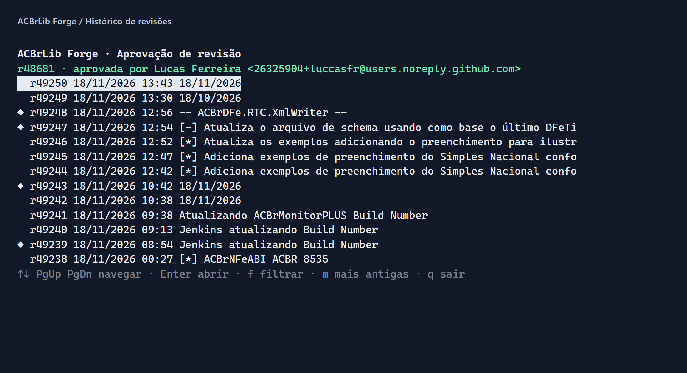

# ACBrLib Forge


[](LICENSE)

Compile a ACBrLib ConsoleMT a partir de uma revisão do SVN oficial do ACBr, com a mesma receita em desenvolvimento e no release. O Forge gera bibliotecas por plataforma, inclui os schemas da NF-e e registra a origem e o SHA-256 de cada arquivo.

Projeto independente para os [fontes públicos do Projeto ACBr](https://projetoacbr.com.br/fontes/).

A r48681 passou na matriz dos quatro alvos e tem aprovação assinada. [Resultado da matriz](https://github.com/luccasfr/acbrlib-forge/actions/runs/44365366311) · [Aprovação da r48681](changes/r48681-ci44365366311.md)

## Por que existe

Integradores precisam saber exatamente qual revisão da ACBrLib está em uso e quais binários foram testados. O Forge liga a revisão e a receita de build aos arquivos que chegam ao release.



## Escolha seu ponto de partida

| Quero… | Comece aqui |
| --- | --- |
| Usar uma biblioteca compilada | Baixe o pacote do seu sistema em [Releases](https://github.com/luccasfr/acbrlib-forge/releases) (Linux x64 e macOS). |
| Compilar no meu computador | Siga [Compilar a partir dos fontes](#compilar-a-partir-dos-fontes). |
| Avaliar uma atualização do ACBr | Use [Revisar uma candidata](#revisar-uma-candidata). |
| Aprovar uma revisão e preparar um release | Siga o [guia de release](RELEASING.md). |

## Compilar a partir dos fontes

Instale Git e Bun. No Windows e no Linux, tenha Docker com contêineres Linux. No macOS, instale as ferramentas de linha de comando do Xcode e rode `brew install fpc subversion openssl@3`.

No diretório do clone:

```sh
bun install --frozen-lockfile
bun run forge build
```

| Alvo | Compilação | Teste de carga | Em Releases |
| --- | --- | --- | --- |
| Linux x64 | Docker | No contêiner | Sim |
| Windows x64 | Compilação cruzada no mesmo Docker | Python x64 no Windows | Não ([motivo](RELEASING.md#windows)) |
| macOS Apple Silicon | Lazarus/FPC nativo | No macOS arm64 | Sim |
| macOS Intel | Lazarus/FPC nativo | No macOS x64 | Sim |

No Windows, teste as DLLs com `python scripts/smoke.py out windows-x86_64`. Os alvos Windows x86 e Linux arm64 ainda aguardam comprovação em build limpo e teste de carga nativo.

O Docker fixa a imagem Debian por digest e os fontes do Free Pascal e do Lazarus por SHA-256; os pacotes apt seguem as atualizações do Debian 12. No macOS, o FPC e o OpenSSL vêm do Homebrew e acompanham a versão disponível no momento do build. Por isso, um build local pode diferir dos binários aprovados; o `manifest.json` registra a toolchain de cada alvo.

Os módulos padrão são **BAL**, **PosPrinter**, **NFe** e **AbecsPinpad**. Todos usam ConsoleMT com multithreading, `cdecl` e sem interface gráfica. O módulo NFe usa `NOREPORT`. Para compilar só NFe no PowerShell, por exemplo:

```powershell
$env:ACBR_MODULES = 'NFe'
bun run forge build
Remove-Item Env:ACBR_MODULES
```

| Variável | Uso |
| --- | --- |
| `ACBR_REV` | Escolhe a revisão do SVN. O padrão vem de `acbr.lock`. |
| `ACBR_MODULES` | Lista de módulos ConsoleMT separados por espaços. O padrão vem de `modules.json`. |
| `ACBR_TARGETS` | Limita o build aos alvos indicados, compatíveis com o host. |
| `ACBR_OUT` | Define o diretório de saída. O padrão é `out/`. |
| `ACBR_DOCKER=1` | Usa Docker no macOS para produzir os alvos Windows e Linux. |

## Usar a saída

```text
out/
├── manifest.json
├── <plataforma>/       bibliotecas e dependências empacotadas
└── schemas/NFe/       schemas para validação de XML
```

Configure o seu aplicativo para carregar a biblioteca da arquitetura correspondente e preserve as dependências do pacote ao lado dela. No Linux, OpenSSL 3 e libxml2 vêm do sistema. O macOS usa a libxml2 do sistema e inclui OpenSSL no pacote.

Cada pacote de release é um `.tar.gz` para um alvo. Extraia-o com `tar -xf <arquivo.tar.gz>`. O pacote contém `out/`, o `SOURCES.md`, as licenças e os avisos de terceiros. Os [fontes correspondentes](docs/fontes-correspondentes.md) explicam como obter os fontes de cada parte. Compare o SHA-256 do arquivo baixado com o valor publicado em `SHA256SUMS`.

O Docker reutiliza o volume `acbrlib-forge-svn-cache-v1` para os fontes. Para recuperar espaço, remova esse volume quando nenhum build estiver em execução. Ele será recriado no próximo build.

## Revisar uma candidata

```sh
bun run forge review
bun run forge review 48681
```

O primeiro comando abre o navegador de revisões do SVN no terminal. O segundo compila a revisão indicada em `out-candidate/`, preservando a saída regular e a aprovação registrada. A aprovação exige a matriz de testes e um commit assinado com SSH. Consulte o [guia de release](RELEASING.md) para aprovar, reaprovar ou voltar a uma revisão anterior.



## Contribuição e licenças

A receita original foi criada por Lucas Ferreira. O código original do Forge usa a [licença MIT](LICENSE). Os trechos e patches de terceiros seguem os termos indicados nos [avisos de terceiros](THIRD_PARTY_NOTICES.md). Veja também o [guia de contribuição](CONTRIBUTING.md).

**English summary.** ACBrLib Forge builds ConsoleMT libraries on Windows, Linux and macOS, records native test evidence and packages the same approved binaries for release.
